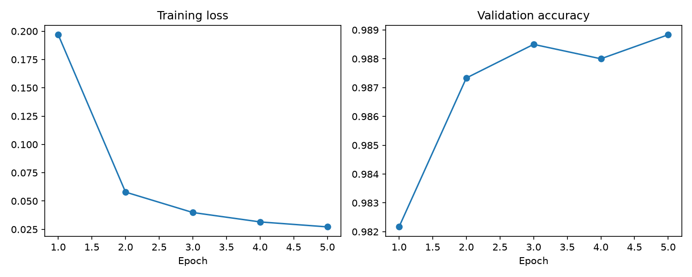
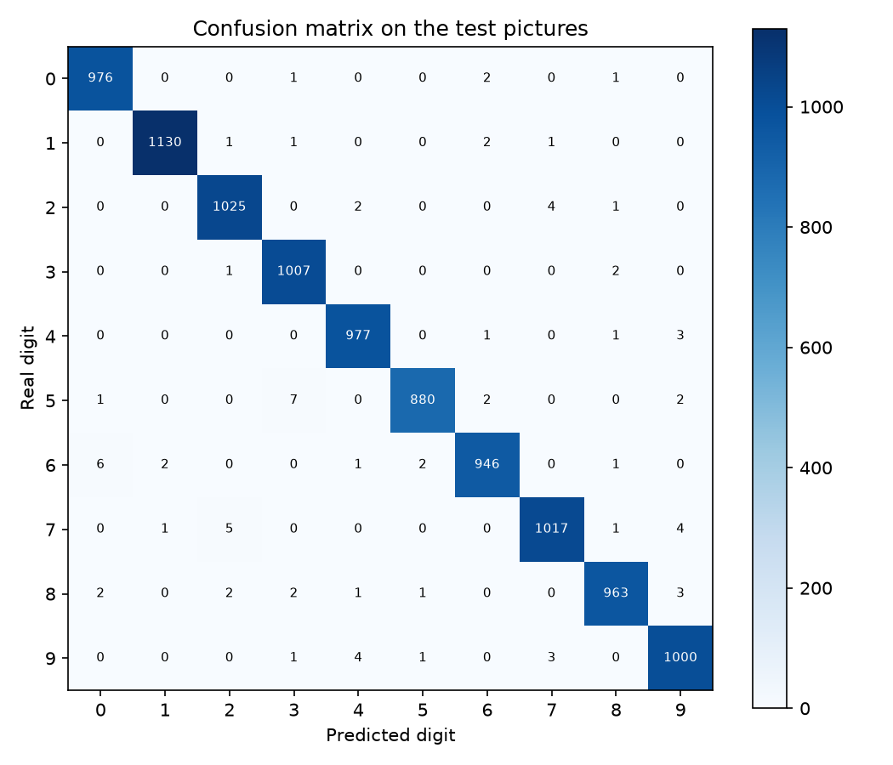
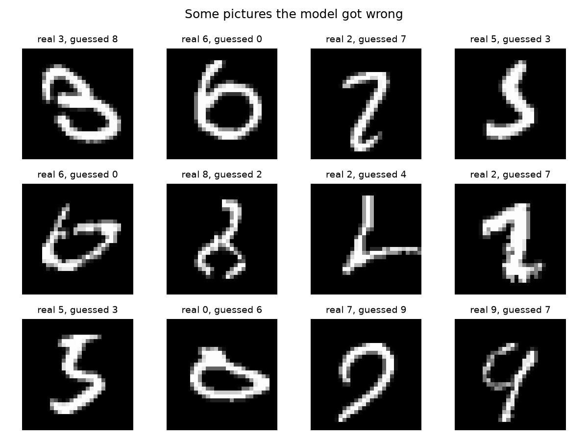

# Handwritten Digit Recognition

This is my Task 3 project for the CodeAlpha Machine Learning internship.
The goal is to teach a computer to read handwritten digits (0 to 9)
from small pictures.

## Project video

on my linked in profile

## What this project does

I built a Convolutional Neural Network (CNN) that looks at a picture of
a handwritten digit and says which digit it is. A CNN is a good choice
for pictures because it first finds small patterns, like edges and
curves, and then puts them together to recognise the whole digit.

## The data

I used the MNIST dataset. It has 70,000 grey pictures of handwritten
digits, each 28 x 28 pixels. The script downloads it by itself the first
time you run it.

- 54,000 pictures for training
- 6,000 pictures for validation (to watch the learning)
- 10,000 pictures for the final test, used only once at the end

## How the model works

1. Two rounds of "find small patterns, then shrink the picture"
   (convolution layer, ReLU, max pooling).
2. A dropout step that randomly switches off some values, so the model
   does not just memorise the training pictures.
3. Two fully connected layers that turn the patterns into one score for
   each digit from 0 to 9. The highest score is the answer.

I trained it for 5 rounds (epochs) with the Adam optimizer on the CPU.
I used PyTorch, because TensorFlow does not install on the Python
version I have (3.14).

## Results

Test accuracy: 0.9921
Wrong pictures: 79 out of 10,000

```text
Epoch 1/5: training loss 0.1969, validation accuracy 0.9822
Epoch 2/5: training loss 0.0579, validation accuracy 0.9873
Epoch 3/5: training loss 0.0399, validation accuracy 0.9885
Epoch 4/5: training loss 0.0316, validation accuracy 0.9880
Epoch 5/5: training loss 0.0272, validation accuracy 0.9888

Test accuracy: 0.9921
Wrong test pictures: 79 out of 10000

Result for each digit:
              precision    recall  f1-score   support

           0      0.991     0.996     0.993       980
           1      0.997     0.996     0.996      1135
           2      0.991     0.993     0.992      1032
           3      0.988     0.997     0.993      1010
           4      0.992     0.995     0.993       982
           5      0.995     0.987     0.991       892
           6      0.993     0.987     0.990       958
           7      0.992     0.989     0.991      1028
           8      0.993     0.989     0.991       974
           9      0.988     0.991     0.990      1009

    accuracy                          0.992     10000
   macro avg      0.992     0.992     0.992     10000
weighted avg      0.992     0.992     0.992     10000
```

### Learning curves


### Confusion matrix


### Pictures the model got wrong


## What I found

The training loss went down in every epoch, from 0.1969 to 0.0272. The
validation accuracy went up fast in the first two epochs and then stayed
around 98.8%. The final test accuracy was 99.21%, with 79 wrong pictures
out of 10,000, so the test result is close to the validation result and
I see no sign of overfitting. The digit 1 was the easiest one (about
99.6% precision and recall). The digits 5 and 6 had the lowest recall
(98.7%), so the model missed a few more of those, and the digits 3 and 9
had the lowest precision (98.8%).

[SENTENCE 1: WRITE WHICH TWO DIGITS THE MODEL MIXED UP MOST OFTEN, FROM
THE CONFUSION MATRIX.]

[SENTENCE 2: WRITE WHAT YOU SAW IN THE WRONG PICTURES, FOR EXAMPLE IF
THEY WERE HARD FOR A HUMAN TO READ TOO.]

## Limits of this project

- It only reads single digits, not letters, words or sentences.
- MNIST pictures are clean and centred, so real photos of handwriting
  would be harder.
- I trained for only 5 epochs and did not tune the settings.
- I used one random seed, so the result can change a little each run.

## How to run it

```
python3 -m venv .venv
source .venv/bin/activate
python -m pip install torch torchvision --index-url https://download.pytorch.org/whl/cpu
python -m pip install numpy scikit-learn matplotlib
python handwritten_digit_recognition.py
```

The pictures and the trained model are saved in the `results` folder.

## Tools used

Python, PyTorch, torchvision, scikit-learn, NumPy and Matplotlib.

 #Lessons taken
